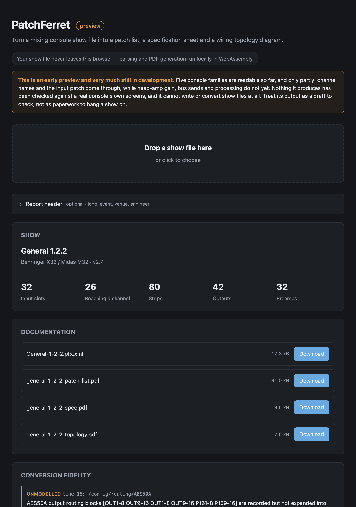

# PatchFerret user guide

PatchFerret turns a mixing console show file into paperwork an engineer can actually use: a patch
list, a specification sheet and a wiring topology diagram, as PDFs.

It runs in the browser or on the command line. The browser build parses and renders entirely in
WebAssembly, so a show file never leaves the machine. There's no upload and no server.



*The hosted tool with the repo's own X32 fixture loaded. It's identified the show as a Behringer X32 / Midas M32 scene, counted its 32 input slots, 80 strips and 42 outputs, and lined up the four documents it makes ready to download, along with the conversion-fidelity list naming the lines of the file it didn't model. Parsed in the browser, and nothing was uploaded.*

> **Before you rely on this:** the X32 adapter is written against a real 2,104-line scene file
> saved by an actual console and is asserted against it in CI. **No output has ever been loaded
> back into a console**, and **no conversion between consoles exists yet.**
>
> The per-format caveats matter here, and they're in the table below. The Yamaha MMS adapter's
> **patch-source encoding has never been confirmed against a console's patch screen**, and on TF
> no connector resolves at all; the tool tells you so rather than guessing. The X32
> signal-source enumerations are derived from community documentation and corroborated against
> real files, not from a running desk.
>
> This codebase was created with AI assistance, directed and reviewed by a human author.

---

## What it reads today

| Console | File | Status |
|---|---|---|
| Behringer X32 / Midas M32 / X-Air | `.scn` | **Supported** |
| Yamaha DM3 / DM7 / TF | `.dm3s` `.tfs` `.dm7s` | **Supported** — names and input patch; head amps and sends not yet |
| Yamaha CL / QL | `.CLF` | **Supported** — input patch and channel names |
| Allen & Heath Avantis / dLive | `.tar.gz` | **Supported** — input patch and strip inventory; names and preamps not yet |
| Allen & Heath SQ | `NVDATA.DAT` | **Supported** — input patch; names and socket *class* not yet identified |
| DiGiCo, Avid VENUE | — | Planned |

```
show file  →  format adapter  →  PFX model  →  ├─ patch list PDF
                                               ├─ specification PDF
                                               ├─ topology PDF
                                               └─ PFX interchange XML
```

---

## Run `info` first, and read the fidelity list

```bash
patchferret info myshow.scn
```

It prints a summary and, more importantly, **the fidelity list**: everything the adapter read
but couldn't carry into the model, which would therefore be lost in a conversion.

That list is the honest measure of how much of your show this tool understands. Read it before
you hand a PDF to anybody.

---

## Why the patch list is not obvious

On an X32, getting from an XLR to a fader takes three hops, and all three have to be composed:

1. The routing block maps blocks of **eight physical connectors** onto the 32 **input slots**.
2. The channel config selects which **input slot** feeds each channel, and that's a free
   mapping.
3. The head-amp table holds the gain for a **connector**, in a flat index across local and both
   AES50 links.

Assume channel *N* is fed by XLR *N* and you get a patch list that's confident and wrong. In
the test fixture, slots 25–32 are AES50-B connectors 1–8 while channels 25–32 carry them, and
six channels reach no connector at all.

PatchFerret composes the chain and marks the dead rows rather than inventing a connector for
them.

---

## The report header comes from you

Reports carry a header with your logo, the event, the venue, the engineer and so on.

None of that is in a show file (a console stores a mixer state, not the job it was built for),
so it comes from a job sheet you supply:

```bash
patchferret job-template -o job.txt
patchferret report myshow.scn -j job.txt -o ./docs
```

The sheet is `key: value` lines, and **any key it doesn't recognise becomes an extra header
field**, so "Truck call" or "Rider rev" work without the tool knowing about them:

```
Event: Summer Live 2026
Venue: Old Granada Studios
Engineer: A. Sargeant
Truck call: 06:00
logo: ./logo.jpg
```

The browser version has the same fields as a form and accepts any image for the logo,
converting it on a canvas before handing the bytes over. The CLI takes JPEG, or PNG without
transparency. Embedding a transparent PNG would mean decoding pixels, which the dependency-free
PDF writer doesn't do on purpose, and it tells you so rather than silently dropping the logo.

---

## In the browser

Module scripts and WebAssembly **won't load from `file://`**, so the local build has to be
served over HTTP. The hosted version needs nothing.

---

## If something is wrong

| Symptom | Cause |
| --- | --- |
| **Rows are marked dead** | Those channels reach no connector. That is the console's patch, faithfully reported. |
| **A patch list disagrees with the desk** | Read the fidelity list from `info` — the adapter may not carry that field yet. |
| **No connector resolves on a TF file** | Known: the tool reports it rather than guessing. |
| **The logo was refused** | A transparent PNG on the CLI. Use JPEG, or the browser version. |
| **The page will not load locally** | It is being opened from `file://`. Serve it over HTTP. |
